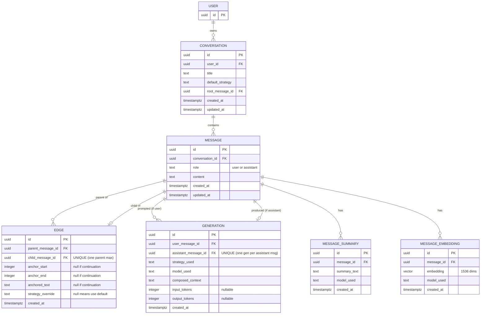

# Dendrite — Complete Decision Record

Single source of truth for Dendrite. Covers the thesis, scope, evaluation plan,
data model, and the full database schema. Written to be read top-to-bottom by
a new contributor (or a fresh AI session) with no prior context.

Rule: **re-read before changing scope.** Reopening a locked decision requires a
new record that supersedes the relevant section, not a casual pivot.

---

## 1. Thesis

Existing branching AI chat tools treat conversational context as either fully
inherited or fully isolated — a binary that wastes tokens or loses information.
Dendrite introduces **structured, graph-aware context composition**. When a user
branches from a highlighted span within a parent response, the child branch
receives a hierarchically composed context: the span at full fidelity, the
parent at medium fidelity, and older ancestors at decaying fidelity. Beyond a
depth threshold, ancestors are compressed into summaries with retrieval
drill-down — a two-tier memory system where summaries are the default and full
text is retrieved on demand when relevance justifies the cost. Evaluated against
linear-context and full-inheritance baselines using an LLM-judge framework,
measuring **answer quality per token**.

Load-bearing terms:

- **Graph-aware context composition** — context is built by walking the
  conversation graph, not concatenating linear history.
- **Hierarchical fidelity decay** — content closer to the branch point is
  higher fidelity; distant content decays toward summary.
- **Two-tier memory** — summaries by default beyond a depth threshold; full text
  retrieved on demand.
- **Retrieval drill-down** — a relevance-scoring step decides when to swap a
  summary back to the original text.
- **Quality per token** — the evaluation metric. The ratio, not raw quality or
  raw cost.

---

## 2. Differentiator

Three legs; if any is missing the differentiation collapses. Protect all three
through MVP.

1. **Span-level branching** — the feature. Unfilled in the competitive
   landscape (see section 3).
2. **Hierarchical context composition with retrieval drill-down** — the
   technical substance under the feature.
3. **Published evaluation results** — the rigor that turns it from a hack into a
   portfolio piece.

---

## 3. Competitive Landscape

| Tool | Model | Gap vs Dendrite |
|---|---|---|
| **gitchat** | Miro-like canvas; each prompt/response is a node joined by arrows | Mostly a UI project. No familiar chat interface. No span selection. No context management. |
| **Prompt-Tree** | Message-as-node DAG; 3-layer memory (user profile, memory bank, folder doc); multi-model; compression | Strongest player. Branches on multiple-models, not on span selection. No published evaluation. |
| **treeGPT** | Message-pair nodes on a canvas; vim keybindings; model routing | Branch button per node — no span-level branching. Chat window still clutters. No evaluation. |
| **HN-surfaced tools** | Various | Same pattern: branch off a whole response, never a selected span. |

Two industry-wide gaps Dendrite fills: **span-level (sub-response) branching**,
and **published, rigorous evaluation** of the context strategy. Dendrite competes
on being *more principled*, not more featured.

---

## 4. Scope

### In MVP

1. Linear chat with **span-anchored branching**. Select any contiguous span in
   an AI response, create a child branch anchored to it. Anchor survives reload.
   DAG, one parent per node.
2. **Hierarchical context composition**. Anchor span full text + parent full
   text + older ancestors summarized via a swappable decay function.
3. **Two-tier memory** beyond depth N (default 3). Ancestors stored as summaries
   + embeddings; a retrieval step drills down to full text for top-k relevant
   hits.
4. **Pluggable context strategies** (see section 5), selectable per-branch and
   per-eval-run.
5. **Evaluation framework** (see section 7).
6. **Persistence + multi-user auth**. Real DB, users, sessions.
7. ~~**Minimal coherent UI**. Sidebar tree navigation.~~ **Widened — see
   section 8.10 (2026-08-30).** The UI is now a first-class deliverable built
   in parallel with the backend, including a public landing page and a brand
   system.

### Not in MVP (closed, not open for casual reopening)

~~Canvas/graph visualization (→ MVP+1, first post-MVP task)~~ **moved into MVP,
see section 8.9** · real-time collab
(v2/v3, budget 8–12 wks) · sibling-branch bridging (v2, manual only) ·
multi-model branching · tools/MCP · mobile UI · user-facing "compress chain into
node" · fork-entire-conversation (post-MVP; note that branching already covers
sub-conversation forking — a whole-conversation fork is a separate, deferred
feature).

### The canvas decision

**Superseded by section 8.9 (2026-08-30).** Retained for the record:

> Deferred to MVP+1 (Path C). Rationale: canvas is the most aesthetic but least
> novel part; trading it against retrieval drill-down would weaken the thesis.
> Recruiters look at current repo state, not history — no penalty for it landing
> a week after MVP.

---

## 5. Context Strategies (five)

| # | Strategy | What it sends to the model |
|---|---|---|
| 1 | `FullInheritance` | Entire ancestor chain at full text (naive baseline). |
| 2 | `ParentOnly` | Immediate parent message only. |
| 3 | `SpanOnly` | The anchored span only — no ancestors. **Valid on branches only** (a continuation has no span, and never inherits it — see 8.13). |
| 4 | `HierarchicalDecay` | Span full + parent full + older ancestors summarized. The contribution without retrieval. |
| 5 | `HierarchicalDecayWithRetrieval` | Full thesis — decay plus retrieval drill-down. |

Context construction sits behind an interface with these five implementations,
selectable at runtime. This is the architectural concession that makes A/B
evaluation possible without code changes. **The interface as built — what the
strategies are handed, what they return, and how a degradation is reported — is
in 8.16.**

**Decay function is swappable.** `HierarchicalDecay` is a family, not one fixed
algorithm — the decay function (the rule setting how fidelity drops per ancestor
level: linear, exponential, custom) lives behind its own interface and can be
swapped without rewriting the strategy. **The interface signature and the one
MVP implementation (`TieredDecay(full_depth=3)`) are in 8.15 D5** — it takes the
whole chain, not a bare depth, because "exponential" and "custom" cannot be
expressed otherwise.

### Strategy selection (what is actually decided)

Automatic selection is deliberately minimal — this is the *entire* trigger logic,
there is no question-type classifier:

- Branches **default to `SpanOnly`** at creation; the user may override to any of
  the five. (The default is applied at *resolution* time — a branch edge with a
  null `strategy_override` resolves to SpanOnly; nothing is written into the
  row. See 8.13.)
- Continuations do not pick their own strategy — they inherit via walk-up (see
  section 6).
- `Conversation.default_strategy` is the user's choice for the whole
  conversation, set at creation (excludes SpanOnly).

Strategies are otherwise compared **by the eval harness**, not auto-chosen at
runtime.

---

## 6. Data Model — Conceptual (locked)

Six entities. A "chat window" the user sees is a **view** (a path through the
graph computed at render time), not a stored entity.

- **Conversation** — top-level container. Owns user_id, title, default_strategy,
  root_message_id. Branching does *not* create a new Conversation; the whole DAG
  is one Conversation.
- **Message** — the atom. `role` = user | assistant. A user prompt and an AI
  reply are *separate rows*, not a fused turn.
- **Edge** — parent→child relationship as its own table. Anchor fields populated
  → **branch**; null → **continuation**. No discriminator column needed.
- **Generation** — the record of producing one AI message: strategy_used,
  model_used, composed_context, token counts. One per assistant message; many
  per user message (that's what powers eval + regeneration).
- **MessageSummary** — derived summary; FK on this side, so one message → many
  summaries.
- **MessageEmbedding** — derived vector; FK on this side, so one message → many
  embeddings.

Key rules (locked):

- **Message-as-node, not turn-as-node** — so the eval harness can reuse one user
  message across five strategies; streaming lifecycle; anchors point into AI
  text; regeneration is a new row.
- **Anchors store offsets AND text.** Offsets = fast render path + disambiguate
  repeated text. Text = repair mechanism: if the parent is edited, fuzzy-match
  the stored text to relocate the anchor; if not found, the edge is *orphaned*
  and flagged, not silently reattached.
- **Anchor repair is only for edits.** Regeneration makes a new sibling message
  (old content untouched); summarization writes a derived row (canonical
  untouched). Only edits mutate canonical content.
- **Regeneration never deletes.** A new Generation + new assistant Message; the
  old message stays so branches anchored into it keep working. Storage grows —
  accepted; storage is cheap, user trust is not.
- **Summaries/embeddings are separate tables** carrying `model_used` +
  `created_at`, so model swaps need no migration.

### Strategy lives in three places

| Field | On | Meaning |
|---|---|---|
| `default_strategy` | Conversation | User's choice for the whole conversation. Excludes SpanOnly. |
| `strategy_override` | Edge | Set when a branch overrides the default. Null on continuations and on branches that accept the default — **by convention, not enforcement.** Nothing in section 9 forbids one on a continuation edge, and a non-null value there does resolve; section 7's eval harness wants exactly that. See 8.13. |
| `strategy_used` | Generation | Historical record of what actually ran. |

Intent (`default_strategy` + `strategy_override`) and history (`strategy_used`)
are not expected to stay in sync — different jobs.

**Strategy resolution — walk up until you find an override.** For any message,
take its parent Edge; if `strategy_override` is non-null, use it; else walk to
the parent of that edge's parent message and repeat. Reach the root with no hit →
fall back to `Conversation.default_strategy`. Most-specific override wins; nested
branches govern their own subtree.

**Narrowed by 8.13:** the walk stops at the first *branch* boundary rather than
always climbing to the root — an anchored edge answers with its override if it
has a usable one, and with `Conversation.default_strategy` if it does not. That
is what reconciles this paragraph with section 5's "branches default to
SpanOnly", and it is also why `SpanOnly` is never inherited downward.

---

## 7. Evaluation Framework (part of MVP, not a stretch goal)

- **Task set:** 20–30 curated multi-turn scenarios that exercise sub-response
  branching. Synthetic + adapted-from-public acceptable.
- **Quality signal:** LLM-as-judge, 1–5, with a documented rubric. Chosen over
  human rating (doesn't scale), embedding similarity (measures similarity not
  correctness), task-specific metrics (don't generalize). Rubric design is where
  rigor shows.
- **Baselines:** the five strategies in section 5.
- **Metrics:** answer quality (judge score), total tokens (in+out), **quality
  per token** (headline).
- **Deliverable:** a markdown report in the repo, linked from README, including
  negative results if any strategy fails to beat baselines.

Note: failed Generations have null token counts — the harness must filter them
out when summing tokens, or quality-per-token math is polluted.

---

## 8. Architecture Decisions

### 8.1 Database — Postgres + pgvector (single system)

One database, not Postgres + a separate vector store (Pinecone/Qdrant/Weaviate).

Rationale: MVP scale is low thousands of embeddings — pgvector handles it with
room to spare. A second stateful system doubles the backup/monitoring/outage
story and opens a consistency gap (Postgres write succeeds, vector write fails →
silent retrieval degradation). For a solo dev at 8–10 hrs/week the operational
tax outweighs any performance the second system would buy. "Postgres + pgvector,
trade-off explained" is also a stronger senior signal than reaching for a
brand-name vector DB.

Insurance: the embedding call site sits behind a thin `EmbeddingStore`
interface (`index`, `query`, `delete`). One implementation for MVP; swapping is
possible later without touching call sites.

Migration trigger (name it, don't hand-wave "if we get big"): revisit only when
embedding count reaches the hundreds of thousands *and* retrieval p95 latency
under real concurrency exceeds the 1–2s composition budget.

### 8.2 Embedding isolation — one table, isolation by query

All embeddings live in **one `MessageEmbedding` table**. Conversations/users are
*not* separated into per-conversation tables or per-user databases (both are
known anti-patterns: migration pain, catalog/autovacuum overhead, tiny useless
indexes). Isolation is a *logical* property enforced in the query: every
retrieval filters by ancestor set (recursive CTE) + `model_used`, and implicitly
by conversation/user via the foreign keys.

Because isolation is logical, guard the failure modes:

- **Forgotten WHERE = cross-tenant leak.** Every data-access function takes
  `user_id` as a required param; authorization lives in one layer. Optional
  belt-and-suspenders: Postgres Row-Level Security.
- **Embedding-model drift.** Embeddings from different models live in different
  vector spaces and aren't comparable. The `model_used` filter protects every
  retrieval query — never omit it.

### 8.3 IDs — UUID v7 everywhere

UUID v7 for all primary keys. Reasons: unguessable (no count leakage in URLs,
matters for a multi-user, URL-addressable product), app-side generation lets you
build a whole related-row graph in memory before insert (see branch-creation
scenario), eval fixtures are easier to construct deterministically. UUID v7
specifically embeds a timestamp so rows sort in creation order — this removes the
classic random-UUID(v4) index-insert penalty.

Caveat to state correctly: **UUID is defense-in-depth, not access control.** Real
isolation is the `user_id` filter on every query; unguessable IDs just raise the
cost of exploiting a bug in that filter.

### 8.4 Ancestor-walk indexing — recursive CTE for MVP

Both hot walks are cheap: a recursive CTE with a B-tree on
`edge.child_message_id` does each level in one *single-row* index lookup — the
column is UNIQUE, so each level matches at most one row — and strategy
resolution *early-terminates* at the first override.

Context composition's walk climbs **to the root**, with a safety cap of 200 as
a runaway guard (this is 8.6's "chain unusually deep → cap the walk, accept
truncation"). Depth is affordable because the recursion carries only
`(edge_id, message_id, depth)`; content and anchors are joined out once the
loop finishes.

**This sentence used to read "context composition walks a *bounded* depth
(~3)", which was wrong — corrected 2026-09-02, see 8.13.** The `~3` is a
**fidelity tier**: how many ancestors arrive at *full text*, which is the decay
function's business (section 5 locks that swappable) and not the query's. Read
as a bound on the walk it makes section 5's `FullInheritance` — "the **entire
ancestor chain** at full text" — unbuildable, and leaves `HierarchicalDecay`
with no older ancestors to summarize, collapsing it into full inheritance and
reducing section 7's five baselines to three.

Do **not** add path enumeration or a closure table pre-emptively — they don't
help bounded/early-terminating walks and add write cost + a re-parenting
correctness risk. Escalation path only if measured slow: (1) recursive CTE →
(2) denormalized `depth_from_root` column → (3) path enumeration (likely only
when the MVP+1 canvas needs whole-tree reads) → (4) materialized ancestor table.
Skip stages you don't need.

**Edge topology is immutable (LOCKED).** Anchor repair changes
`anchor_start`/`anchor_end`/`anchored_text` only. An Edge's `parent_message_id`
and `child_message_id` are set once at creation and never change — there is no
re-parenting in MVP. Every ancestor-walk query (context composition and strategy
resolution) relies on this: the tree shape walked yesterday is the same today, so
cached paths, any future `depth_from_root`, and any future closure table stay
valid. A "move branch to a new parent" feature would break this assumption and
requires its own superseding decision record.

### 8.5 Summarization — async, lightweight

Summaries generated **asynchronously in the background** after a message is
created (not eager — most messages never reach depth N; not lazy on request —
adds latency). MVP infra: FastAPI BackgroundTasks or **arq** (asyncio queue on
Redis). Not Celery — its priorities/routing/multi-broker features solve problems
Dendrite doesn't have. Upgrade path to Celery stays open.

### 8.6 Context-composition latency — 1–2s budget, graceful degradation

Target for the whole compose step before the LLM starts streaming: 1–2s
end-to-end. Failure modes get deliberate fallbacks, never silent failure:

- Embedding service down → fall back to `HierarchicalDecay` (no drill-down).
- Summary not yet generated → use full text for that ancestor (costlier, still
  correct).
- Chain unusually deep → cap the walk, accept truncation.

### 8.7 Implementation decisions (Phase 2 build session, 2026-07)

These were decided during the first implementation session, when section 9 was
silent on them. Recorded here to keep the spec and the code in sync.

**Async SQLAlchemy.** The data layer uses `asyncpg` + SQLAlchemy 2.0 async ORM
(`create_async_engine`, `async_sessionmaker`, `expire_on_commit=False`), not sync
`psycopg` + classic sessions. Rationale: the stack is already async-first
(FastAPI, arq per section 8.5) and the workload is I/O-bound and latency-sensitive
(section 8.6) — matching the stack avoids a sync/async impedance mismatch.
Declarative models remain compatible with sync sessions if ever needed.

**User stub table.** A minimal `User` table (`id` uuid PK only, no other columns)
was added so `Conversation.user_id`'s foreign key has a real target and
referential integrity holds from day one. This is an *implementation stub, not
the final auth design* — the full auth model (columns, provider choice) remains
deferred to the Weeks 3–6 backend block (section 12). The stub is extended, not
replaced, when auth lands.

**`text` enforced at the Base.** The "text everywhere" rule (section 9) is
enforced globally via `type_annotation_map = {str: Text}` on the declarative
`Base`, rather than by writing `Text` on each column. This makes every bare `str`
column render as Postgres `TEXT` automatically and prevents silent drift back to
`VARCHAR` on future models. (Caught during review: without the map, SQLAlchemy
infers `VARCHAR` for `Mapped[str]`, which contradicted section 9.)


### 8.8 Backend block decisions (Weeks 3–6, decided 2026-07-29)

The three Weeks 3–6 open items from section 12, taken together because they
interact. All three are now **decided**; section 12 lists them as resolved.

**Auth — roll-your-own minimal.** Session-based auth written in-repo: the `User`
stub (section 8.7) gains `email` + `password_hash` (argon2 via `passlib`), a
signup/login pair of routes, and a `get_current_user()` FastAPI dependency that
resolves the session cookie into a `User` and makes `Conversation.user_id` real.
Rejected Supabase/Clerk/Auth0: hosted auth keeps its user records in the
provider's store, which would mean a second database alongside `dendrite-pg` and
a mirror-row sync path to keep the `user_id` FK valid — real complexity bought
for a column this project barely reads. The usual "never roll your own auth"
advice targets production systems holding real users' credentials; this is a
solo project with no real users, where the learning value is the point and the
exposure is nil. Revisit if Dendrite ever takes outside users.

**LLM provider — thin abstraction from day one.** One `LLMClient` protocol
(`generate` + `embed`) with a single concrete implementation behind it; call
sites depend on the protocol, never on a vendor SDK. Three subsystems call a
model — generation, embeddings (section 9 `MessageEmbedding`), and async
summarization (section 8.5) — and section 7 makes comparative evaluation part of
the MVP, so varying model or vendor mid-experiment is expected, not
hypothetical. Refactoring call sites during an eval run is how measurements get
silently corrupted. The abstraction also makes a `FakeLLMClient` possible, which
is what allows context composition to be tested without network calls or spend.
Explicitly *not* a provider registry with config-driven routing — that is the
speculative-infrastructure anti-pattern in section 13.

**Deployment — SSE now, long-lived container when deployed.** Streaming uses
Server-Sent Events (`StreamingResponse`), not websockets: generation is
server→client only, so the websocket's duplex channel buys nothing against its
connection-lifecycle cost. Websockets get reconsidered only if real-time collab
lands (out of MVP per section 4). Hosting targets a long-lived container
(Fly.io/Render class), not serverless: cold starts alone can consume the entire
1–2s context-composition budget (section 8.6) before any logic runs, serverless
request-duration caps fight a 30s+ open stream, and a connection pool is
worthless in a process that dies between requests. Hosting stays local
(Docker) through the eval phase — the transport half of this decision is what
touches code, and it is settled now.


### 8.9 Graph view moved into MVP (supersedes section 4, decided 2026-08-30)

Section 4 closed canvas/graph visualization to MVP+1. That deferral is
**reversed**; the graph ships inside MVP alongside the sidebar tree. Recorded
here rather than edited away, per the repo rule that locked decisions are
superseded in writing and never pivoted silently.

**What changed the calculus.** The original rationale was cost against the
thesis — canvas is the most aesthetic and least novel component, so time spent
on it is time not spent on retrieval drill-down. Two facts revise the cost
estimate, both of which follow from decisions already locked elsewhere:

1. **It is a tree, not a general graph.** Section 4 locks *one parent per node*.
   A DAG in which every node has exactly one parent is a tree, so layout is
   deterministic — depth sets the row, sibling order sets the lane. No
   force-directed simulation, no graph engine, no physics tuning. This is the
   single biggest cost reduction, and it was always true; it simply was not
   noticed when the deferral was written.
2. **It is entirely frontend.** No new endpoint, no schema change, no
   backend work. It consumes the same ancestor-walk (section 8.4) the tree
   already needs.

**Explicitly rejected: a graph library.** React Flow, D3-force and Cytoscape
solve layout for graphs whose structure is unknown. Ours is known. Worse, a
force-directed layout settles differently on each load, so two screenshots of
the same conversation would not match — actively harmful for a project whose
deliverable is published evaluation (section 7). Hand-rolled SVG over a
deterministic layered layout, no dependency.

**Both views ship; neither replaces the other.** The sidebar tree remains the
persistent navigator — it is better for reading a single root-to-leaf path, for
keyboard navigation, and at narrow widths. The graph is a second view over the
same selection state, so switching preserves the selected node and refetches
nothing.

**Rendering decision — fused turn nodes.** The graph draws a user message and
its assistant reply as one card. This is a *rendering* choice only; section 6's
message-as-node rule is untouched and remains locked. The fusion **splits
automatically** whenever a user message has more than one assistant child, which
is exactly the eval fan-out (one prompt, five strategies) and regeneration cases
that message-as-node exists to represent. Common case reads clean; the case the
thesis depends on stays truthful.

**Sequencing constraint — the part that protects the original rationale.**
Section 4's concern was ordering, not difficulty. ~~Slices 1 through 4 and the
evaluation framework of section 7 ship **before** the graph.~~ **Revised
2026-08-30, together with section 8.10:** the graph is gated on its own backend
prerequisite — the recursive-CTE ancestor walk of section 8.4 and the edge
routes — rather than on a fixed slice order. It is built when that backend
lands, in parallel with whatever else is in flight.

**What did not change:** the evaluation framework of section 7 is still not
traded against the graph. If the two ever compete for the same session, section
7 wins and the graph reverts to MVP+1 without renegotiation. The deferral was
reversed because the work is cheaper than believed, not because the thesis
became less important.

**Static specimens are not the slice.** As of 2026-08-30 the frontend contains
presentational graph components (`MiniGraph` in `frontend/src/components/
specimen.tsx`, rendered on the landing page and the auth panel). These are
hardcoded illustrations with no data, no interaction and no layout algorithm —
marketing surfaces, not the navigator. **The graph slice remains unstarted.**
Do not read the existence of those components as progress against this entry.

### 8.10 UI scope widened; frontend built in parallel (supersedes section 4 item 7, decided 2026-08-30)

Section 4 listed the UI as "**Minimal coherent UI**. Sidebar tree navigation",
and section 13 names "UI before backend rigor" as an anti-pattern. Both were
written when the UI was understood as a thin viewer over the interesting part.
That is revised.

**What changed.** The UI is now a first-class deliverable, built **in parallel**
with the backend rather than after it, feature by feature — each frontend slice
tracks a backend capability that has actually shipped. Scope now explicitly
includes a public landing page, a brand mark and a full design-token system
across two themes, on top of the in-app surfaces section 4 anticipated.

**Why.** Section 2 makes *published evaluation results* one of three legs of the
differentiator, and the audience for those results reaches them through a
front door. A tool that cannot be looked at cannot be shown. The parallel
cadence also keeps the frontend honest: it can only be built against endpoints
that exist, which prevents the speculative-UI failure mode section 13 is really
worried about.

**What section 13's guardrail still means.** "UI before backend rigor" is not
repealed — it is narrowed to its real target: *building UI for capabilities the
backend does not have*, and *trading evaluation work for visual work*. Both
remain anti-patterns. Visual polish on a surface whose backend already ships is
not.

**The constraint that replaces the old one.** A frontend slice may not begin
before the backend capability it renders exists. Concretely: frontend slice 2
(conversation list) is blocked until the conversation routes are written, and
the graph view is blocked until section 8.4's ancestor walk lands — see the
revision to section 8.9 above.

**Where the detail lives.** `docs/frontend_design.md` is the companion record
for the frontend: stack, the locked palette (its section 5), the anti-generic
constraints (its section 4), and the slice order (its section 8). It is
subordinate to this document; where they disagree, this one wins.

### 8.11 Conversation-layer decisions (decided 2026-08-31)

Recorded in the spirit of section 8.7 — things the code now embodies that
section 9 was silent on, plus one addition to a LOCKED set. Written when the
conversation routes landed.

**Create-time `default_strategy` is `HierarchicalDecayWithRetrieval`, and the
field is optional at the API.** Section 9 gives `Conversation.title` a column
default (`'Untitled'`) but deliberately gives `default_strategy` none, and
section 5 says only that it is "the user's choice for the whole conversation,
set at creation." `POST /conversations` therefore makes the field **optional**,
falling back to `DEFAULT_STRATEGY` in `app/models/_shared.py`.

This **narrows section 5's wording**: a client need not supply a strategy, and
most will not — frontend slice 2 creates conversations from a "New chat"
affordance with no strategy picker in front of it.

The value is the full thesis rather than plain `HierarchicalDecay` because it is
the thing the project exists to test, and because it costs nothing to set before
retrieval exists: section 8.6 already specifies degrading to
`HierarchicalDecay` when the embedding service is unavailable, which is exactly
the state of the world until the embedding pipeline lands.

The default lives in **app code, not DDL** — no column default was added, so
section 9's schema is untouched.

*Considered and deferred:* an adaptive, budget-aware strategy ("send the
ancestor chain in full while it fits; decay only when it doesn't" — what linear
chat products effectively do). Captured in `ROADMAP.md` as an **eval hypothesis
with a trigger**, not built. Three reasons it is not the default: section 1's
metric is quality *per token*, so spending because there is room is the
wastes-tokens half of the binary this project rejects; context that merely fits
is still distractor context, and backfilling it contradicts the span anchor the
user placed; and an adaptive strategy blurs the eval by behaving as
`FullInheritance` on short conversations while recording a different name. It
also may not bind — section 8.4 bounds the ancestor walk at roughly depth 3, so
at MVP scale it would resolve to `FullInheritance` nearly always.

**`conversation.user_id` gains a B-tree index — a seventh entry in section 9's
LOCKED starting set.** A foreign key does not index the column that holds it;
Postgres indexes the referenced side (`user.id`, already a PK) and leaves the
referencing side bare. `conversation.user_id` is filtered on by *every*
authenticated conversation query — the authorization discipline of
`auth_design.md` section 4.3 guarantees it — so it was a sequential scan on the
most-executed predicate in the app. Measured on 200k rows with one match:
planner cost 4167 → 8.44, pages read 1664 → 4.

This is not a reopening of the "no speculative indexes" rule. That sentence
defers **composite and partial** indexes pending a measured slow query. This is
a single-column index on an FK that is filtered on, which is the criterion
section 9 states for the six it already blesses; `conversation.user_id` was
absent only because no route existed when the set was written.

### 8.12 Message-layer decisions (decided 2026-09-01)

Recorded when the message + edge write layer (`POST|GET
/conversations/{id}/messages`) landed. Six things section 9 was silent on or
that narrow a locked rule. Same spirit as 8.11: the code now embodies these, so
they belong here rather than in a session log.

**A `Generation` row belongs to every *generated* assistant message — not to
every assistant message.** This narrows section 6's "One per assistant message;
many per user message."

`POST .../messages` accepts either role, so a client can write assistant text
with no Generation behind it. That is not a stopgap awaiting the generation
layer: section 7's eval harness has to run five strategies against **fixed**
conversation graphs, and the assistant messages in a fixture were authored, not
generated, so there is nothing for a Generation row to record. The same is true
of any imported or seeded conversation.

The invariant the eval actually needs is the one already expressed in the
schema: `generation.assistant_message_id` is UNIQUE, so a generated message can
never acquire two Generation rows. "Every assistant message has one" was
stronger than necessary and is not enforceable without forbidding fixtures.

*Consequence to watch:* a query that joins Message to Generation to find out
which strategy produced an assistant message must treat a missing row as "not
generated", not as a data error.

**Empty `content` is refused by the API and still permitted by the column.**
Section 9 annotates `Message.content` "empty string allowed (streaming starts
blank)", and that stays true — generation will insert a blank assistant message
and stream into it. That write is server-side and never passes through
`MessageCreate`, so the request schema requires `min_length=1` after stripping.
A narrowing at the API layer only; no DDL, no CHECK.

**`conversation.root_message_id` is write-once.** Section 9 says "NULLABLE (set
after first message)" and is silent on a second attempt. It is now settable
exactly once: a parentless message posted to a conversation that already has a
root is a **409**, and the first message never loses its claim.

The claim is a **conditional UPDATE**, not read-check-write:

```sql
UPDATE conversation SET root_message_id = :new_id
WHERE id = :conversation_id AND root_message_id IS NULL
```

`rowcount = 0` means someone else won. Read-check-write is wrong here because
two concurrent first messages both read `root_message_id IS NULL` and both then
write, and the second silently orphans the first root — a message reachable by
nothing, which no later query would surface. The database arbitrates instead.

This makes `root_message_id` immutable in the same sense section 8.4 locks edge
topology: every ancestor walk terminates at the root, so a root that can move
invalidates the same assumptions a re-parented edge would.

**A parent message must belong to the same conversation, enforced in app
code.** Section 9's `edge.parent_message_id` is a plain FK to Message and none
of the five CHECK constraints restricts *which* conversation the parent sits in.
No CHECK can: a CHECK sees only the row being written, and the answer lives in
another table.

So the guard is one condition inside the parent lookup — `Message.conversation_id
== conversation.id`, on a Conversation already resolved through the ownership
choke point. Without it, `parent_message_id` is a way to hang a branch off a
stranger's message and pull their text into a composed context once the
composition layer exists. A failure answers **404, not 403**, for the same
reason as the conversation routes.

Recorded here because it is a security boundary that lives entirely outside the
schema, and section 9 gives a reader no hint that it exists.

**Anchor offsets and text must agree at creation.** Section 6 says anchors store
offsets *and* text, and explains what each is for, but never says they must
start out consistent. They must: repair works by fuzzy-matching the stored text
to relocate the offsets, which is meaningless if the two never described the
same span. The service therefore rejects an anchor whose `anchor_end` runs past
the parent's content, or where `parent.content[start:end] != anchored_text`, as
a **422**.

Also not expressible as a CHECK — same reason as above, the text being pointed
at is in another row.

**`conversation.updated_at` moves on every message write.** Section 9 leaves
Conversation's `updated_at` unannotated, while annotating Message's "(moves only
on edit)". Conversation's now tracks message activity, so "most recent first"
in the conversation list means most recent *activity*. Nothing else would move
it — a message write touches `message` and `edge`, not `conversation` — and
without it a busy conversation would sort by the moment it was created.

*Related:* the open item on `Message.updated_at` under streaming (section 12)
is unaffected. That column still moves only on edit, and the question of what
streaming does to it is still parked on its trigger.

**Two shape decisions, for the record.** Neither touches a locked rule.

- **One request writes the message and its edge**, in one transaction. A
  separate `POST /edges` would leave a window in which a message exists with no
  link — an invalid graph state that nothing can find and nothing cleans up.
- **`GET .../messages` returns two flat lists**, `messages` and `edges`, rather
  than a nested tree. Two plain SELECTs server-side, and the client builds its
  own parent→children map. Consistent with section 6: a chat window is a view
  computed at render time, not a stored entity — so the server should not be
  the one choosing which path through the graph to nest.

*Not added:* a role-alternation rule (`user` must follow `assistant`). Section 6
makes a node one message rather than one turn, and section 6 locks "regeneration
never deletes", so a user message with two assistant children is a legal graph.
An alternation check would have to be removed the moment generation lands.

---

### 8.13 Ancestor-walk and strategy-resolution decisions (decided 2026-09-02)

Decided ahead of the B2 build (the section 8.4 ancestor walk and strategy
resolution by walk-up), the way 8.12 was decided ahead of B1. Seven items: one
clarifies 8.4 in a way that materially changes the build, one reconciles two
locked sentences that pointed different ways, and five are shape decisions the
spec is silent on.

**The "~3" in 8.4 is a fidelity tier, not a bound on the walk.** Section 8.4
says context composition "walks a *bounded* depth (~3)". That sentence is about
cost, and reading it as a hard cap on the query breaks two strategies outright.

Section 5's `FullInheritance` is "the **entire ancestor chain** at full text" —
unbuildable if the walk stops at three. `HierarchicalDecay` is "span full +
parent full + **older ancestors summarized**", plural and open-ended; cap the
walk at three and there are no older ancestors to summarize, the summarization
layer of 8.5 has nothing to do, and decay becomes byte-identical to full
inheritance. Section 7's eval would then be comparing five strategies of which
three are secretly the same one.

Compounding it: message-as-node (section 6) means one conversational exchange is
*two* rows. Three ancestors is one and a half exchanges of history.

So the three numbers are now named separately:

| | What it limits | Value |
|---|---|---|
| The recursive CTE | how far the walk climbs | to the root; safety cap 200 |
| The strategy | how many ancestors reach the prompt | per strategy (0 for SpanOnly, 1 for ParentOnly, all for the rest) |
| The decay function | how many arrive at *full* fidelity | ~3 — this is 8.4's number |

The walk carries only `(edge_id, message_id, depth)` through the recursion, so
depth costs one single-row index lookup per level and no message text; content
and anchors are joined out once the loop finishes. A 200-level walk is ~1ms.
Distant ancestors are expensive in *tokens*, not in query time, and answering
that is the decay function's job, not the walk's.

The cap of 200 is a runaway guard, not a working setting — edge topology is
immutable (8.4) and `child_message_id` is UNIQUE, so a cycle is not currently
constructible; the cap exists so a future bug cannot spin the loop forever.
Section 8.6's "chain unusually deep → cap the walk, accept truncation" is this
valve. The walk returns a `truncated` flag so a capped result is visible rather
than silently short, detected by recursing one level past the limit and
discarding that row.

The `~3` accordingly lives in the decay function, which section 5 already locks
as swappable — which is where section 7 wants to vary it anyway.

**Strategy resolution never crosses a branch boundary.** Two locked sentences
pointed different ways. Section 5: "Branches **default to `SpanOnly`** at
creation." Section 6: "if `strategy_override` is non-null, use it; else walk to
the parent... Reach the root with no hit → fall back to
`Conversation.default_strategy`." B1 stores a null override when the client
sends none, so for an anchored edge with a null override, section 5 says
SpanOnly and section 6 says keep walking.

The reconciliation is in section 6's own table, which permits null "on
continuations **and on branches that accept the default**". Null on a branch is
therefore legal and must *mean* something; section 5 says what. Null on a
continuation means the other thing — keep walking.

The resolution rule, in full:

| Situation | Answer | `source` |
|---|---|---|
| Message has no parent edge (it is the root) | `Conversation.default_strategy` | `conversation_default` |
| Own parent edge is anchored, override null | **`SpanOnly`** | `branch_default` |
| Nearest usable non-null override found | that override | `edge` |
| Branch boundary reached with nothing usable | `Conversation.default_strategy` | `branch_boundary` |
| Root reached, no hit | `Conversation.default_strategy` | `conversation_default` |
| Safety cap reached | `Conversation.default_strategy` | `depth_cap` |

"Usable" excludes exactly one thing: `SpanOnly` seen from below. Section 5 locks
it "valid on branches only (a continuation has no span)", so a continuation two
levels inside a SpanOnly branch must not resolve to it — that would compose the
branch's anchored span and drop everything typed inside the branch since, which
is not a strategy anyone chose.

So **any anchored edge ends the walk**: with its override if it has a usable
one, with the conversation default if it does not. Three consequences, all
wanted:

- A branch is a deliberate context reset — the thesis of the whole project. An
  override set on the trunk should not reach across a branch point into a
  subtree the user opened precisely to get away from that context.
  Conversation-wide intent already has a home in `default_strategy`, and that is
  a value the user actually chose rather than one chosen about a different part
  of the tree.
- Section 6's "nested branches govern their own subtree" still holds: an
  explicit override *on* the branch edge is inherited by everything below it,
  which is the `edge` row above.
- The walk is bounded by the distance to the nearest branch above you. The only
  deep walk is in a conversation with no branches — the case where Dendrite is
  doing the least interesting work, and still ~1ms.

Expressing it in SQL needs no special case: the recursion continues only while
the edge just found is a continuation with a null override. Everything else
terminates the loop, and the terminating row is interpreted in app code.

**Resolution returns a source, not a bare strategy string.** The result carries
`strategy`, `source` (the six values above), and the deciding `edge_id` where
one exists. Three reasons: `depth_cap` and `branch_boundary` are degradations
that section 8.6 requires be visible rather than silent; tests can assert *why*
an answer was reached, so a right answer arrived at by a wrong path fails
instead of passing; and `Generation.strategy_used` plus the 8.9 navigator's
"why did this message get this strategy" both want it.

**The walk returns ancestors only, nearest first, each with its connecting
edge.** The starting message is not included — the caller already holds it, and
a depth-0 row invites off-by-one errors in the composer. The parent is depth 1.
Each step carries the `Edge` linking the level below to it, which is not
optional: for the first step that edge holds the anchor, and the anchor is the
entire input to `SpanOnly` and the "span full" half of `HierarchicalDecay`.
Nearest-first because fidelity decays with distance and a strategy may stop
early; the composer reverses the list when it assembles the prompt.

**The walk filters on `conversation_id` inside the CTE.** Every ancestor must
sit in the conversation the walk was handed. Nothing can currently create a
cross-conversation edge — 8.12 makes that an app-layer check in the message
service — but the walk is the thing that eventually pulls ancestor *text* into a
prompt, so if that guard ever leaked this is where a stranger's message would
arrive in someone's composed context. One extra condition on a row already
fetched, no measurable cost, and the walk is then safe on its own terms rather
than by trusting a check made elsewhere.

**The walk takes an already-owned `Conversation`, never a bare message id.**
Same shape as `create_message`: the signature is `(session, conversation,
message_id)`, so a caller cannot reach the walk without the ownership choke
point in `app/services/conversation.py` having run. The starting message is
resolved through the same `Message.conversation_id == conversation.id` filter
B1's parent lookup uses — extracted into one shared loader, since the two
lookups are identical. A message id that is not in this conversation answers
**404**, for the same reason as 8.11 and 8.12: a 403 confirms the id exists.

**`strategy_override` on a continuation edge stays permitted.** Section 6's
table says the column is "Null on continuations", and nothing in section 9
enforces it — the five Edge CHECK constraints do not, and neither does
`MessageCreate`. That is left as-is deliberately, not overlooked.

Section 6's line describes *intent*, and the resolver handles a non-null
override on a continuation correctly either way (non-null wins, null keeps
walking). Forbidding it would cost a new CHECK, a migration and an autogenerate
review, to remove a capability section 7's eval harness plausibly wants:
pinning a strategy at an arbitrary point in a fixture graph without going
through the branch machinery. Meanwhile the user-facing control for "change
strategy from here on" already exists and needs no new code — `PATCH
/conversations/{id}` accepts `default_strategy`, and resolution reads it live at
compose time, so the change applies to later compositions while
`Generation.strategy_used` keeps the record of what each past reply used.

A finer-grained per-message override is a UI question, not a schema one, and is
logged in section 12: an override a user can set but cannot see is worse than
not having one.

---

### 8.14 Streaming write pattern (decided 2026-09-02)

Resolves section 12's open item on `Message.updated_at` under streaming, whose
trigger was "when generation lands". Decided before Layer C is built rather
than during it, because it is not really a question about a column — it is
"how does generation write a streaming reply", and that shapes the generation
code.

**The stream is buffered in memory and `content` is written once, at
completion.** Not persisted chunk by chunk.

```
INSERT message (content = '')      -- once, so the UI has a row to stream into
   ... chunks go straight to the client over SSE, buffered server-side ...
UPDATE message SET content = <full text>   -- once
INSERT generation (...)                    -- once, same transaction
```

**Why, in order of weight.**

*Anchors make chunk-by-chunk writes worse here than in an ordinary chat app.*
Section 6 locks anchors as "offsets AND text", and an offset into a string that
is still growing describes nothing. Persisting the stream would create hundreds
of moments where a row is real, visible to any query, and not yet anchorable.
Buffering means a message is only ever blank or final.

*The crash argument for the alternative is weaker than it looks.* Its whole
advantage is that a mid-stream crash loses nothing — but section 6 locks
"regeneration never deletes", so the recovery path for a failed generation is
already to generate again into a new row. Half a persisted reply is not a saved
reply; it is a truncated one that would be regenerated anyway. Section 8.8 also
puts hosting on a long-lived container rather than serverless, so death
mid-request is rare rather than routine.

*It keeps a promise that would otherwise have to be broken.* Section 9
annotates `Message.updated_at` "(moves only on edit)" and the model carries
`onupdate=func.now()`, which fires on *any* UPDATE SQLAlchemy emits. With one
write at completion both stay true as written. Persisting the stream would need
a second mechanism to keep the column honest — a raw UPDATE bypassing the ORM,
or dropping `onupdate` and setting it by hand on every edit path — the kind of
arrangement that is fine when written and wrong six months later.

*Consequence to watch, and it is the reason the next item exists:* the blank
INSERT means a `GET .../messages` firing mid-stream returns a message whose
`content` is `''`. That is correct and intended, but a client cannot tell it
apart from a message that is genuinely empty. **What the graph shows about an
in-flight generation is a separate decision and is not taken here** — resolved
2026-09-03, see 8.15 D1.

---

### 8.15 Layer C decisions — generation, composition and the LLM client (decided 2026-09-03)

Decided ahead of the Layer C build, the way 8.13 was decided ahead of B2 and
8.14 ahead of the streaming write. Twelve items: one resolves section 12's open
item on in-flight generations, one corrects a supporting claim in 8.14, and ten
are shape decisions the spec is silent on.

**D1 — An in-flight generation is derived from blank content, not stored.**
`MessageOut` gains a computed `pending: bool` — `role == "assistant" and
content == ""`. No column, no migration.

This is safe only because of 8.12, which narrowed the API to refuse empty
`content` (`min_length=1` after stripping). A blank *assistant* row therefore
cannot be created by any client; the generation route's blank INSERT is the only
thing in the system that produces one, so blankness already *means* "a
generation happened here".

Section 12's other two candidates both fail. Deriving "generating" from a
missing `Generation` row contradicts 8.12 — a missing row means **not
generated** (hand-authored fixtures, which section 7's eval depends on), so every
fixture assistant message would render as forever-generating. Hiding the row
until it has text breaks 8.12's "every node and every link as two flat lists":
the edge would have to be hidden with it, so the client's parent→children map
would point at a message absent from the list, and the streaming tab's own reply
would vanish on refresh.

A `status` column was rejected as a migration against LOCKED section 9 for
something derivable — and it does not fix the staleness case that is its main
argument. A process that dies between the blank INSERT and the completion UPDATE
runs no exception handler, so the column sits at `'generating'` forever exactly
as a blank row does.

*Accepted cost:* an abandoned generation reads `pending` forever. D9 makes this
recoverable without a column — a failed generation **has** a `Generation` row
while an in-flight one does not, so combined with `content == ''` the three
states separate with one extra query.

**D2 — The generate route takes an existing user message id.**
`POST /conversations/{id}/messages/{message_id}/generate`, where `message_id` is
the **user** message being replied to. Nested under the existing `/conversations`
prefix, so no new Vite proxy entry.

8.12's "one request writes the message and its edge" argument does not extend
here. A message with no edge is *unreachable*; a user message with no reply is a
legal, visible state — an unanswered question with a retry affordance, which is
needed anyway because generation can fail on its own.

The decisive reason is section 6's "many Generations per user message".
Regeneration and section 7's five-strategies-against-one-message both must name
an *existing* id, so this route has to exist regardless; a second route accepting
raw text would duplicate it.

*Consequence for the frontend:* the stream comes back from a `POST`, so the
browser's `EventSource` (GET only) cannot be used — read it with `fetch()` and a
`ReadableStream` reader.

Also ruled out: splitting trigger from stream (`POST` returns 202, a separate
`GET` streams) so that `EventSource` would work. The server would then have to
hold the in-progress stream somewhere both requests can reach, which breaks
silently the moment there is more than one worker process.

**D3 — The composed prompt replays ancestors as real multi-turn messages.**
Not one envelope holding the transcript as text. Two rules make it work:

- A **summarized ancestor keeps its original role**, with its content prefixed
  `[summarised]`. A summary of what a participant said is honestly attributed to
  that participant, so no role is invented.
- If the oldest verbatim turn would be an **assistant** turn, prepend
  `{"role": "user", "content": "(earlier in the conversation)"}`. `messages[0]`
  must be a user message on every current provider. This fires only for
  `ParentOnly` on a branch — `FullInheritance` and `HierarchicalDecay` both climb
  to the root, and the root is a user message.

The rejected alternative was a uniform envelope: a `system` preamble plus a
single `user` message holding the whole transcript as text, identical in shape
across all five arms. It has no special cases and is trivially diffable in tests.
Multi-turn won on three counts: it is the format these models are trained on; it
makes `FullInheritance` a genuinely *naive* baseline ("resend the conversation"),
which is what section 5 asks of it; and it caches far better. Cache hits require
a byte-identical prefix and breakpoints sit on content blocks, so separate
ancestor turns form a stable prefix that grows at the end, while one combined
string is invalidated whole by every new message — and section 7 runs 375
generations per eval run, most of them resending a chain.

*Checked, because it would have killed this:* 8.12 deliberately declined a
role-alternation rule, so a user message may legally have a user parent.
Consecutive same-role messages are accepted and merged by the provider APIs, so
non-alternating chains compose correctly.

`composed_context` stores the whole payload as JSON — `{"system": ...,
"messages": [...]}` — so a past generation is replayable, which is what section
9's "exact context sent to the LLM" requires. A rendered prose blob is not.

**D4 — The anchored span appears in all five strategies, not only `SpanOnly`.**
Section 5's table describes which *ancestors* each strategy sends and says
nothing about the user's own question. The span is part of what the user asked —
the referent of the pronoun in "what does *that* cost me?" — so withholding it
from four arms would have them answering a vaguer question than `SpanOnly`
answers, and `SpanOnly` would win on branches for a reason unrelated to context
composition.

Held constant across arms: the question **and** the highlight. Varying: the
ancestors. Continuations have no anchor, so their final turn is the question
alone — no special case.

**D5 — The decay function takes the whole chain, and has no drop tier.**
Interface: `assign(steps) -> list[Fidelity]`, one entry per step — not
`fidelity_for(depth)`.

Section 5 names "linear, exponential, custom" as the swappable family. An
exponential decay over a *fraction* of the chain needs the chain's length, and a
token-budget decay needs message lengths; a single `depth` argument can supply
neither. The narrow signature would have to be widened by the first swap,
breaking a promise section 5 locks.

One implementation: **`TieredDecay(full_depth=3)`** — depth ≤ 3 full, deeper
summarized. This class is the only place 8.4's `~3` lives (8.13). Depth-based
rather than token-budget-based, so the composed context does not depend on
message lengths — which keeps eval runs comparable across conversations and tests
deterministic. The budget variant stays buildable behind the same interface.

**No drop tier.** Section 5 says older ancestors are *summarized*, not dropped.
Dropping would make decay differ from `FullInheritance` in **coverage** as well
as fidelity, so a token saving could no longer be attributed to summarization. A
`TruncatingDecay` is a later implementation behind the same interface, which is
what the interface is for.

**D6 — Retrieval promotes summarized ancestors back to full text, in place.**
The strategy runs decay first, then re-marks some steps decay marked `summary`
back to `full`. Retrieval only ever considers already-summarized steps, so on a
chain short enough that nothing was summarized it does nothing, and it can never
undo the full-fidelity tier.

Promotion in place rather than appending a separate "relevant excerpts" block:
appending sends the same message **twice** — abbreviated in position, and again
in full out of order — which is waste measured directly by the quality-per-token
metric.

Message-level granularity is not a choice. Section 9's `MessageEmbedding` stores
one vector per message, so there are no chunks to retrieve.

**How many are promoted is a fraction of the summarized count, not a fixed k:**

```
promote_count = min(ceil(fraction * n_summarized), max_promotions)
fraction = 1/3      max_promotions = 10
```

A fixed `k` collapses the arm. With `full_depth = 3`, a chain of depth *D* has
*D − 3* summarized ancestors, so `k = 10` promotes **all** of them on any chain
shallower than depth 13 — six exchanges under message-as-node — and
`HierarchicalDecayWithRetrieval` becomes byte-identical to `FullInheritance` on
most of section 7's fixtures, reducing five baselines to four. The fraction makes
that structurally impossible: two thirds of the summaries always survive. `ceil`
rather than `floor`, so a short chain promotes one rather than zero and the arm
never silently degenerates into plain decay. `max_promotions` is a runaway guard
in the sense of `WALK_SAFETY_CAP`, not a working setting — the walk reaches depth
200, where a third would be 66 full messages.

The query is scoped by the walk's ancestor ids **and** filtered on `model_used` —
both of 8.2's named failure modes in one `WHERE`. Without the ancestor scope the
search would reach sibling branches, which is precisely the context the user
branched away from. The query text is the user's message plus the anchored span,
and that `embed` call is the only network call in compose, so it is where 8.6's
timeout and fallback live.

No similarity threshold in MVP: any value would be a guess, and section 7 is what
produces the data to pick one. `fraction` and `max_promotions` are constructor
args so the harness can sweep them.

**D7 — `strategy_used` records what ran; degradations are not persisted.**
When 8.6's fallback fires, `Generation.strategy_used` is `HierarchicalDecay`, not
`HierarchicalDecayWithRetrieval`. Section 6 already calls the column "the
historical record of what actually ran", against `default_strategy` and
`strategy_override` which are intent.

No new column for the degradation list — and under this rule none is needed,
because degradation is already derivable. The eval harness knows which arm it
asked for and the database records what ran, so a disagreement between the two
*is* a degraded run. "Arm 5 degraded in 40% of runs" — a material finding for
section 7's report, and one that could never be recovered retroactively — is
computable from data already stored.

That works only because of the rule above. Recording *intent* would make a
degraded run indistinguishable from a clean one and force the column.

The degradation list lives in the in-memory compose result, goes out on the SSE
`done` event, and is logged. 8.13's `source` is handled the same way.

**D8 — The completion write sets `updated_at` explicitly. (Refines 8.14.)**
`message.updated_at = message.created_at`, in the same UPDATE that writes
`content`. An explicit value wins over `onupdate`, which only supplies a default
when the column is absent from the SET clause.

8.14 states that section 9's "(moves only on edit)" stays true as written under
buffer-and-write-once. It does not, quite: the model carries
`onupdate=func.now()`, which fires on the completion UPDATE too, so every
generated message would end up with `updated_at > created_at` having never been
edited. This does not reopen 8.14 — buffering and writing once stands — it adds
the one assignment that makes its claim true.

What it buys: `updated_at != created_at` becomes a trustworthy "this was edited"
signal, which matters because section 6 ties **anchor repair** to edits
specifically. Without it, an edited message and a generated one are
indistinguishable, permanently.

**D9 — Two transactions, and a failed generation still writes its `Generation`
row.**

```
compose (reads only)                                    ~1-2s, 8.6
INSERT blank assistant message + edge   -> COMMIT       D1 needs this visible
... stream, buffered in memory, no DB work ...
UPDATE content + updated_at
INSERT generation                       -> COMMIT       one transaction, 8.14
```

Two, not one: a single transaction would sit `idle in transaction` for the length
of the stream, and a handful of concurrent generations would drain the connection
pool. The early commit is also what makes D1 observable — an uncommitted row is
invisible to other connections, so without it no second tab ever sees `pending`.

The completion write uses a session opened from `async_session_factory`, **not**
the request's `SessionDep`. The stream body runs inside the `StreamingResponse`
generator, after the handler has returned, and whether a `yield`-dependency
session is still usable there depends on framework teardown ordering — not
something to depend on.

A failure writes the `Generation` row with **null** token counts and leaves
`content = ''`. Section 7 already anticipates these rows ("failed Generations
have null token counts — the harness must filter them out"), and it preserves
`composed_context`, the only surviving record of what was attempted. Deleting the
blank row was rejected: section 6 locks that regeneration never deletes, the edge
would have to go too, and the evidence would be destroyed.

**D10 — The SSE protocol is four named events, with JSON data throughout.**

| event | data |
|---|---|
| `start` | `assistant_message_id`, `strategy`, `source`, `model` |
| `chunk` | `text` |
| `done` | `generation_id`, `input_tokens`, `output_tokens`, `degradations` |
| `error` | `detail` |

`start` carries the assistant message id because the client needs it before any
token arrives, and the strategy plus 8.13's `source` because 8.9's navigator
wants "why did this message get this strategy".

Chunk text is **JSON-encoded, not raw**. SSE frames are newline-delimited, so a
bare newline inside `data:` ends the frame — and model output is full of them.
The failure would present as the model producing broken markdown.

**Compose runs before the `StreamingResponse` is returned.** Once it is returned
the headers are on the wire with a `200` and nothing can become a 404 or 422, so
resolution, the walk and composition all happen first. The `error` event is
reserved for genuine mid-stream failures.

**D11 — One concrete client, OpenAI, with model ids in config.**
`generate`: `gpt-5.6-luna` at `effort: "low"`. `embed`:
`text-embedding-3-small` (section 9's lock). Section 7's judge: `gpt-5.6-terra`.

Section 9 locks the embedding model, which is OpenAI's, and Anthropic has no
embeddings endpoint — so the vendor question was only ever about generation.
Choosing OpenAI for both makes 8.8's "a single concrete implementation" literal:
one SDK, one key, one set of error types.

Cost, verified 2026-09-03, for one eval run of 375 generations at ~1,500 tokens
in and out: **$0.79 generation + $1.80 judge on OpenAI**, against **$8.78 and
$5.37** for `claude-sonnet-5` and `claude-opus-5` (both of which carry a newer
tokenizer producing ~30% more tokens for identical text). Across five runs plus
manual testing that is ~$13 against ~$75. The **marginal** figure decided it:
$2.59 per additional eval run against $14.15 means the eval gets re-run whenever a
prompt or a decay parameter changes, rather than rationed — and a number measured
once is a number you end up defending rather than trusting.

Quality risk is recoverable rather than absorbed: Luna's `effort` dial runs `none`
through `max` on the same model id, so weak replies are a config change, not a
migration. If section 7's absolute scores disappoint across *all five* arms, that
is the signal to swap the client — which the protocol makes an env change.

**Thinking stays on, held constant across all five arms.** Turning it off was
considered and rejected. Thinking tokens are billed as output and scale with input
size, but that is the *treatment's effect*, not a confound — decay's real saving
is fewer input tokens **and** less thinking on top, and section 7's "total tokens
(in+out)" is written to capture exactly that. Excluding them would understate the
thesis. Three consequences: thinking length varies run to run, so each scenario ×
strategy cell is run three times and averaged (hence 375 generations per run);
thinking tokens cannot be separated from answer tokens, since providers bill them
inside `output_tokens` and expose no split — which is also why no column is
needed; and with reasoning hidden there is a pause between `start` and the first
`chunk`, which the UI renders as a thinking indicator.

Explicitly **not** a provider registry (section 13): `base_url` and `model` are
config values, with no routing logic and no per-request vendor choice.

**D12 — `generate` yields typed events; token counts come from the provider.**
The stream yields `TextDelta` zero or more times and finishes with exactly one
`Completed(text, input_tokens, output_tokens, model)`.

The problem it solves: usage numbers only arrive after the last chunk, and a
Python async generator cannot return a value the `for` loop sees. The
alternatives were a result object with a mutable `usage` field the caller reads
*after* iterating — which works but leaves an ordering rule nothing enforces —
and yielding bare strings while counting tokens locally.

Typed events won on three counts: they map 1:1 onto D10's SSE events
(`TextDelta` → `chunk`, `Completed` → `done`), so the route is a translation loop
with no bookkeeping of its own; there is no mutable state and no ordering rule to
remember, because the type says what you have; and `FakeLLMClient` can script the
sequence exactly, including a failure partway through, which is what tests D9's
failure path.

**Token counts come from the provider's own `usage`, never a local tokenizer.**
Those are the billed numbers — which is what section 7's quality-per-token should
measure — and they already include the thinking tokens D11 decided to count. A
local tokenizer would add a dependency and drift from the invoice. Both fields
are nullable because a stream can die before usage is reported, which is exactly
the case D9 writes as a null-token `Generation` row.

*Logged, not built:* prompt caching for the composed prefix. `FullInheritance`
resends the entire chain every turn, so it is the obvious cost win — but section
13 says ROADMAP.md until measured.

---

### 8.16 Layer C build decisions — the strategy interface as typed (decided 2026-09-05)

Taken while building C1 and C2, when 8.15 was silent on them. Recorded here for
the same reason as 8.7: the code now embodies these, so the spec should say them
rather than leave them to be re-derived. None touches a LOCKED item — no column,
no index, no change to section 5's five strategies or section 6's topology.

**Resources ride on the request; tuning rides on the constructor.**
`StrategyRequest` carries `session`, `llm`, `question`, `anchor` and `walk`. The
strategies themselves are frozen dataclasses taking no arguments, so a single
instance serves every request and C6's dispatch table can hold one of each.

The alternative — a session and a client injected into each strategy's
constructor — forces a fresh set of strategy objects per generation, which
collides with D6: `fraction` and `max_promotions` are constructor arguments
*because* the eval harness sweeps them, and a swept configuration wants to
outlive one request. Splitting it this way keeps the constructor meaning
"how this strategy is tuned" and the request meaning "what this generation is
composing", with no overlap.

Consequence worth naming: `FullInheritance`, `ParentOnly` and `SpanOnly` never
read `session` or `llm`. Carrying two fields three of five implementations
ignore is the price of one uniform signature, and it is cheaper than an
interface that changes shape at C3.

**A strategy names itself.** `ContextStrategy` requires a `name: AnyStrategy`
attribute, and `compose()` stamps it into `ComposedContext.strategy_used` — the
caller never labels the result.

This is what makes D7 mechanically true rather than merely intended. If C6
labelled the result with the strategy it *asked* for, an 8.6 fallback would
record `HierarchicalDecayWithRetrieval` for a run that actually executed
`HierarchicalDecay`, and section 7's "arm 5 degraded in N% of runs" — computable
only by comparing intent against record — would be uncomputable. With the
strategy naming itself, the degraded run cannot misreport.

**`as_payload()` emits `system` and `messages`, nothing else.** Section 9's
`composed_context` is "the exact context sent to the LLM", so the payload holds
exactly what went over the wire: no strategy name (it has its own column), no
degradation list (D7 makes it derivable), no ids or timestamps. A replay is then
a straight resend of the stored object.

**One system preamble across all five strategies.** `SYSTEM_PROMPT` is a module
constant in `app/context/base.py`, identical for every arm. A per-arm preamble
would be prompt engineering entering section 7's results as a
context-composition effect — the same confound D4 rejected for the question
turn, one turn higher up. The wording is a build-time choice, not a locked one;
changing it changes all five arms together, which is the property that matters.

It mentions the `[summarised]` marker even though nothing emits one until C3, so
that the marker is interpretable the moment it appears without the preamble
changing between eval runs.

**The anchored span is fenced, not quoted.** `render_question` wraps the span in
triple quotes on their own lines rather than prefixing it with `> `. An anchored
span is an arbitrary substring of a model reply and can contain newlines, which
would break out of a Markdown blockquote after the first line and silently merge
the rest of the span into the question.

**Truncation is reported only by the strategy it actually degraded.**
`FullInheritance` appends `walk_truncated` to `degradations` when the walk hit
its cap; `ParentOnly` and `SpanOnly` never do, because they read depth 1 and
depth 0 and a cap 199 levels above them changed nothing about what they sent.

The rule generalises: a strategy reports a degradation when the composed context
differs from what that strategy promises, not when something upstream was
imperfect. Reporting truncation from every arm would make the degradation rate
of arms that cannot degrade non-zero, and D7's whole argument is that the
degradation rate is a real finding recoverable from stored data.

**`SpanOnly` raises rather than falling back.** Composing `SpanOnly` for a
message with no anchor raises `SpanOnlyRequiresAnchor`. 8.13 makes resolution
structurally unable to answer `SpanOnly` for a continuation, so nothing in the
app can reach this; section 7's harness names strategies directly, so it is the
one caller that can. A quiet degradation to `ParentOnly` would file one arm's
numbers under another arm's column — the failure mode most damaging to the
deliverable, and invisible in the output.

**Summary selection is "most recent non-blank", with the model filter
deferred — this narrows section 9.** Section 9's `MessageSummary` note names the
selection rule as "most recent for the **active model**". The reader implements
most-recent only, with no `model_used` filter, and additionally excludes rows
whose `summary_text` is blank. Recorded here rather than pivoted silently, per
the repo rule on locked decisions. Two narrowings, decided a day apart: the
deferred model filter below is from C3, the blank-row exclusion further down is
from C4 (2026-09-06).

The filter is not buildable yet. Nothing writes summaries until Layer D, and
D11 names model ids for exactly three call sites — generation, embedding and the
judge. Summarization is not one of them, so "the active model" has no value in
config to compare a row against; implementing the filter now would mean
inventing a fourth model id to make the `WHERE` clause well-formed, which is the
invented-decision failure the working rules exist to prevent.

**The risk being carried is different in kind from 8.2's.** 8.2's "never omit
`model_used`" is about *embeddings*, where two models produce vectors in
different spaces and a mixed query is arithmetically meaningless. Summaries are
text, so a mixed set breaks nothing mechanically. It shows up in section 7
instead: if a message is re-summarized by a better model partway through a
campaign, `HierarchicalDecay` and `HierarchicalDecayWithRetrieval` quietly begin
sending better summaries, and a summarizer upgrade reads as a
context-composition win. Invisible in the output, and confined to the two arms
the thesis depends on.

Two things make that recoverable rather than absorbed:

- **The reader takes an optional model argument, defaulting to `None`.** Turning
  the filter on is then a call-site change, not a rewrite of the reader and its
  tests.
- **Selection orders by `created_at DESC, id DESC`** — both columns, the
  timestamp carrying the ordinary case and the id settling ties. `created_at`
  alone is not enough: rows written in one transaction share a single `now()`,
  so it ties and "most recent" degrades to whatever Postgres returns first. The
  v7 keys of 8.3 sort in creation order, which makes the id a deterministic
  tiebreak and the same answer. *(Corrected 2026-09-06. An earlier version of
  this bullet read "orders by `id DESC`, **not** `created_at DESC`", which the
  shipped reader never did — it has ordered by both since C3.)*

*Trigger for closing this:* when Layer D lands summarization and a summarization
model id enters config, pass it and section 9's rule holds as written.
Immediately, and ahead of that, if summaries are ever regenerated with a
different model while section 7's fixtures exist.

**A blank summary is not a candidate at all (decided 2026-09-06, building
C4).** `load_summaries()` excludes rows whose `summary_text` is empty or
whitespace-only, in the `WHERE`:

```python
func.btrim(MessageSummary.summary_text, " \t\r\n") != ""
```

*Why exclude rather than render it.* A blank summary is not a cheaper version of
the message, it is the message gone. Sending the `[summarised]` marker with
nothing after it would drop that ancestor from the prompt while the arm still
counted it as covered — the coverage-for-fidelity confound D5's no-drop tier
exists to prevent, arriving through the back door.

*Why in the `WHERE` rather than filtered out of the returned map.* The query
keeps only the newest row per message. A blank written today would win on
recency, become that message's summary, and only then be discarded — taking a
perfectly good older summary with it and costing full text for a message that
had one. Excluded in the `WHERE`, the blank never competes.
`test_a_blank_summary_does_not_beat_a_real_older_one` pins this, and failed in
exactly that way before the fix.

*Why the character set is spelled out.* Postgres's `btrim` trims spaces and
nothing else by default, so `btrim("  \n  ")` returns `"\n"` and a
newline-only summary passes an `!= ""` test. The SQL is well-formed and the
query runs either way; only a whitespace test catches the code quietly
disagreeing about what "blank" means.

This keeps "absent from the map means no summary" as the single definition of
the rule, in the one place it already lived, so no strategy needs a special
case: a blank row degrades exactly like a missing one, through
`SUMMARY_MISSING`. **No schema change** — `summary_text` stays `text NOT NULL`
and an empty string remains legal at the database level. The exclusion is a
read-side rule, not a constraint.

**Deliberately deferred, not overlooked.** `Fidelity` and the decay-function
protocol belong to C3, which defines them alongside the interface that consumes
them; the name→strategy registry belongs to C6, which is where dispatch lives.
C2 shipped neither, per the repo's one-layer-at-a-time rule.

---

## 9. Database Schema (field-level, locked)

Global rules:

- **`text` everywhere** — in Postgres `text` and `varchar` have identical
  performance; `varchar(n)` only adds a length cap. Enforce any length limits in
  app code, not the column type.
- All timestamps **`timestamptz`**, `default now()`.
- Strategy fields are **`text` + CHECK**, not native enums — the strategy set
  already grew once (4 → 5); native Postgres enums are a one-way door
  (rename/remove is painful). CHECK constraints are trivial to alter.

### Conversation
| Column | Type | Notes |
|---|---|---|
| id | uuid | PK (v7) |
| user_id | uuid | FK → User, NOT NULL |
| title | text | NOT NULL, default `'Untitled'` (auto-title overwrites it) |
| default_strategy | text | NOT NULL, CHECK in the 4 non-SpanOnly strategies |
| root_message_id | uuid | FK → Message, NULLABLE (set after first message; **write-once — see 8.12**) |
| created_at | timestamptz | NOT NULL, default now() |
| updated_at | timestamptz | NOT NULL, default now() (**moves on every message write — see 8.12**) |

### Message
| Column | Type | Notes |
|---|---|---|
| id | uuid | PK (v7) |
| conversation_id | uuid | FK → Conversation, NOT NULL |
| role | text | NOT NULL, CHECK (role IN ('user','assistant')) |
| content | text | NOT NULL, empty string allowed (streaming starts blank; **the API refuses it — see 8.12**; blank + `role='assistant'` is what `MessageOut.pending` derives from — **see 8.15 D1**) |
| created_at | timestamptz | NOT NULL, default now() |
| updated_at | timestamptz | NOT NULL, default now() (moves only on edit — the stream is buffered and written once (**8.14**), and that one completion write sets this column explicitly to `created_at` so the annotation is literally true (**8.15 D8**)) |

### Edge
| Column | Type | Notes |
|---|---|---|
| id | uuid | PK (v7) |
| parent_message_id | uuid | FK → Message, NOT NULL |
| child_message_id | uuid | FK → Message, NOT NULL, **UNIQUE** (one parent max) |
| anchor_start | integer | NULLABLE |
| anchor_end | integer | NULLABLE |
| anchored_text | text | NULLABLE |
| strategy_override | text | NULLABLE, CHECK in the 5 strategies (null on a branch edge resolves to SpanOnly; permitted on continuation edges — see 8.13) |
| created_at | timestamptz | NOT NULL, default now() |

Constraints:
```sql
CHECK (num_nonnulls(anchor_start, anchor_end, anchored_text) IN (0, 3)) -- all-or-nothing
CHECK (anchor_start IS NULL OR anchor_start >= 0)                       -- non-negative
CHECK (anchor_start IS NULL OR anchor_end > anchor_start)               -- valid span
CHECK (anchored_text IS NULL OR anchored_text <> '')                    -- no empty anchor text
CHECK (strategy_override <> 'SpanOnly' OR anchor_start IS NOT NULL)     -- SpanOnly needs a span
```

### Generation
| Column | Type | Notes |
|---|---|---|
| id | uuid | PK (v7) |
| user_message_id | uuid | FK → Message, NOT NULL |
| assistant_message_id | uuid | FK → Message, NOT NULL, **UNIQUE** (one generation per assistant msg) |
| strategy_used | text | NOT NULL, CHECK in the 5 strategies (what actually ran, so an 8.6 fallback records the degraded strategy — **see 8.15 D7**) |
| model_used | text | NOT NULL |
| composed_context | text | NOT NULL (exact context sent to the LLM — reproducibility; stored as the JSON payload `{"system": ..., "messages": [...]}`, not rendered prose, or it cannot be replayed — **see 8.15 D3**) |
| input_tokens | integer | NULLABLE (null if generation failed pre-count) |
| output_tokens | integer | NULLABLE |
| created_at | timestamptz | NOT NULL, default now() |

### MessageSummary
| Column | Type | Notes |
|---|---|---|
| id | uuid | PK (v7) |
| message_id | uuid | FK → Message, NOT NULL |
| summary_text | text | NOT NULL |
| model_used | text | NOT NULL |
| created_at | timestamptz | NOT NULL, default now() |

No unique constraint — many summaries per message allowed. Selection logic
("most recent for the active model") lives in code. **Narrowed twice, both in
code and neither in the schema: the model half is deferred until a summarization
model id exists in config, and a row whose `summary_text` is blank is excluded
from selection entirely. The reader therefore selects most-recent non-blank; see
8.16.** An empty string remains legal in this column — the exclusion is a
read-side rule, not a constraint.

### MessageEmbedding
| Column | Type | Notes |
|---|---|---|
| id | uuid | PK (v7) |
| message_id | uuid | FK → Message, NOT NULL |
| embedding | vector(1536) | NOT NULL (MVP model: `text-embedding-3-small`) |
| model_used | text | NOT NULL (filter on this in every retrieval) |
| created_at | timestamptz | NOT NULL, default now() |

### Indexes (LOCKED starting set)

Vector index:
```sql
CREATE INDEX ON message_embedding USING hnsw (embedding vector_cosine_ops);
```

B-tree indexes (all single-column, on FKs filtered/joined by):
- `edge.child_message_id` — ancestor walk steps up via "edge whose child is me."
  (Already created by the UNIQUE constraint; listed for clarity.)
- `edge.parent_message_id` — "children of this message" (tree render, branch
  indicators).
- `message.conversation_id` — "all messages in this conversation" (loads every
  conversation open).
- `message_summary.message_id` — summary lookup during context composition.
- `message_embedding.message_id` — join key back to Message during retrieval
  (separate column from the HNSW index, which is on `embedding`).
- `generation.user_message_id` — "all generations for this user message" (eval +
  regeneration history).
- `conversation.user_id` — "all conversations of this user"; filtered on by every
  authenticated conversation query. **Added 2026-08-31 — see section 8.11.**

No composite or partial indexes yet — those are added only after a measured slow
query, not speculatively.

---
# Dendrite — Entity-Relationship Diagram

Companion to section 9 of the decision record. This is the at-a-glance view;
section 9's tables remain authoritative (the diagram cannot show CHECK
constraints — the five on Edge and the strategy-value checks).



## 10. Validation Scenarios

1. **Continuation** — 1 user Message, 1 continuation Edge, 1 assistant Message,
   1 continuation Edge, 1 Generation. All anchor fields null. Strategy resolved
   by walk-up.
2. **Branch creation** — 1 user Message, 1 **branch** Edge (anchors populated,
   `anchored_text` = substring of parent, `strategy_override` = SpanOnly by
   default), 1 assistant Message, 1 continuation Edge, 1 Generation. Note: span
   text lives in `Edge.anchored_text`, not `Message.content`.
3. **Eval, 5 strategies on one user message** — 0 new user Messages (reused), 5
   assistant Messages, 5 Generations (same `user_message_id`), 5 continuation
   Edges. Input fixed, output multiplies — the reason Generation is separate.
4. **Regeneration with existing branches** — old assistant Message stays,
   content unchanged; new assistant Message + continuation Edge + Generation.
   Branches anchored into the old message keep working.

---

## 11. Glossary

- **pgvector** — Postgres extension adding a `vector` column type and
  vector-similarity search. Lets embeddings live in the same DB as everything
  else.
- **`vector(N)`** — column holding an embedding of exactly N numbers. N is fixed
  by the embedding model (`text-embedding-3-small` → 1536). Changing to a model
  with a different N is a schema change.
- **Embedding** — a fixed-length list of numbers representing text meaning.
  Similar text → nearby vectors.
- **HNSW (Hierarchical Navigable Small World)** — an approximate
  nearest-neighbour index for "find the K most similar vectors" fast. Built once
  across the whole table and maintained incrementally on insert; not rebuilt per
  query. Layered graph: sparse top layers give big jumps into the right region,
  dense bottom layer does fine search (like zooming a map country→city→street).
  Approximate — occasionally misses the true top-K, which is fine for relevance
  scoring. Knobs: `m`, `ef_construction`, `ef_search` — leave at defaults until
  measured. Alternative index IVFFlat builds faster/uses less memory but has
  worse recall/speed; HNSW is the right MVP default.
- **How HNSW is actually used at query time** — the planner chooses per query:
  either walk the HNSW index then filter to the ancestor set, or filter to the
  small ancestor set first then brute-force compare. At MVP scale the ancestor
  filter is so selective the planner often picks brute force and HNSW may not
  fire — that's fine; the index costs little and starts paying off for free once
  chains grow. Your job: create the index and write a clear
  filter-then-order-by-distance-limit-K query; Postgres decides the rest.
- **Distance metric** — how vector similarity is scored. **Cosine** for
  Dendrite (OpenAI embeddings are normalized; operator class `vector_cosine_ops`).
  Alternatives: L2, inner product.
- **Decay function** — the rule controlling how much fidelity each ancestor keeps
  as you move away from the branch point (linear, exponential, custom). Swappable
  behind an interface; `HierarchicalDecay` is a family of behaviours, not one.
- **Recursive CTE** — a SQL query that references itself, used here to walk up
  the Edge chain from a message to its ancestors.
- **Closure table / path enumeration** — precomputed ancestor structures.
  Deliberately *not* used in MVP (see section 8.4).
- **UUID v7** — 128-bit unique ID with a timestamp prefix, so IDs sort by
  creation time (index-friendly) while staying unguessable.
- **bigserial** — auto-incrementing integer ID. Rejected: guessable, leaks
  counts, no app-side pre-generation.
- **Row-Level Security (RLS)** — Postgres feature letting the DB itself restrict
  which rows a connection sees. Optional belt-and-suspenders for tenant
  isolation.
- **arq** — lightweight asyncio background-job queue on Redis. MVP choice for
  async summarization over the heavier Celery.

---

## 12. Open Items (next sessions)

Each is pinned to either a milestone or a trigger condition — none is floating.

- ~~**What the graph shows about an in-flight generation.** Section 8.14 buffers
  the stream and writes `content` once at completion, which leaves a blank
  message row visible for the duration — correct, but indistinguishable from a
  genuinely empty message to any client reading `GET .../messages`. The
  candidates are a `status` column on Message, deriving "generating" from the
  absence of a completed `Generation` row, or keeping the row out of the graph
  response until it has text.~~ **RESOLVED 2026-09-03** → derived, not stored:
  `MessageOut.pending` is computed as `role == "assistant" and content == ""`,
  which 8.12's refusal of empty `content` at the API makes unambiguous. No
  column; section 8.15 D1 records why the other two candidates fail.
- ~~**`Message.updated_at` semantics under streaming.** Section 9 annotates the
  column "(moves only on edit)" while the model carries `onupdate=func.now()`,
  which fires on any UPDATE — so persisting a stream chunk by chunk would make
  the annotation false.~~ **RESOLVED 2026-09-02** → the stream is buffered and
  written once, so both stay true as written; section 8.14.
- **Per-message strategy override in the UI.** The column already accepts one on
  any edge (8.13), and the resolver already handles it, so this is a surface
  question rather than a schema one: an override a user can set but cannot see
  is worse than not having one. The `source` field on a strategy resolution
  (8.13) is what such a display would read. Until then, `PATCH
  /conversations/{id}` with a new `default_strategy` is the user-facing control
  for "compose everything from here on this way". *Trigger: when the chat
  surface can display which strategy produced a reply, and why.*
- ~~**"Current summary" selection rule** in code (when a message has several
  summaries) — *trigger: when selection actually matters, likely Weeks 7–14.*~~
  **RESOLVED 2026-09-06** → most-recent non-blank, ordered `created_at DESC, id
  DESC`, with the `model_used` filter available as an optional argument and off
  until a summarization model id exists in config. Section 8.16 carries all
  three parts and why each narrows section 9 without touching the schema.
- **How the tunable arms get their hyperparameters, and on what data.**
  Section 7 names the task set, the judge, the metrics and the deliverable, but
  says nothing about hyperparameter selection. `TieredDecay(full_depth=...)` is
  a constructor argument so the harness can sweep it, and D6's `fraction` and
  `max_promotions` exist for the same reason — which leaves arm 4 with one knob
  and arm 5 with three, against zero for `FullInheritance`, `ParentOnly` and
  `SpanOnly`. Sweeping on the same scenarios the results are reported from would
  give the tuned arms N attempts where the baselines get one, and part of any
  margin would then be "we tried five settings and kept the winner" rather than
  a finding about context composition. The likely answer is a tuning/reporting
  split: hold back roughly 8 of the 20–30 scenarios, sweep there, freeze the
  values, then run all five arms once on the remainder. Cost argues the same
  way — 25 scenarios x 5 arms x 3 repeats is 375 generations, and sweeping five
  tier values across all of them doubles the run where an 8-scenario tuning set
  costs 120. The sweep curve is worth reporting in its own right: if
  quality-per-token is flat from `full_depth` 2 to 6, the win comes from
  summarizing at all rather than from where the line is drawn, which is a real
  result. *Trigger: before the eval harness is built — it decides how the
  fixtures are split, so it cannot be retrofitted.*
- **Full failure-mode list** for each context-composition step + its fallback —
  partly answered by 8.15 (D6 fixes the retrieval timeout and its fallback, D7
  fixes how a degradation is recorded and recovered), so what remains is the
  summarization and embedding-write paths in Layer D. *Trigger: near the
  strategy-interface implementation, Weeks 7–14.*
- **`User.display_name`** (nullable text) — deliberately NOT added with auth:
  nothing renders a user name yet, and a nullable column is equally cheap to
  add later. `username` was considered and rejected outright — a public handle
  buys nothing without a social surface, and costs a second unique constraint,
  case-folding rules, reserved-name blocking, and ambiguity in the login
  lookup. *Trigger: when the frontend needs to display a user's name.*
- ~~**Auth approach** (roll-your-own vs Clerk/Supabase/Auth0) — affects
  `user_id`.~~ **RESOLVED 2026-07-29** → roll-your-own minimal, section 8.8.
- ~~**LLM provider abstraction** (single vs abstracted from day one)~~
  **RESOLVED 2026-07-29** → thin abstraction from day one, section 8.8.
- ~~**Deployment target** (affects streaming: SSE vs websocket, cold-start
  tolerance)~~ **RESOLVED 2026-07-29** → SSE + long-lived container,
  section 8.8.

Condition-based deferral ("solve when X becomes true") is deliberate here — it's
more honest than forcing a calendar date onto a question you don't yet know
enough to answer.

---

## 13. Anti-Patterns (guardrails)

Scope creep via "wouldn't it be cool" → capture in ROADMAP.md, don't build ·
re-litigating closed decisions → write a superseding record instead · UI before
backend rigor · skipping evaluation because "it feels right" · adding features
just because Prompt-Tree has them · under-budgeting real-time collab (8–12 wks
when it comes).

Scope-expansion impulses peak exactly when you can least afford them (excited
week 3, bored week 10, almost-done week 16). Trust the locked scope.
